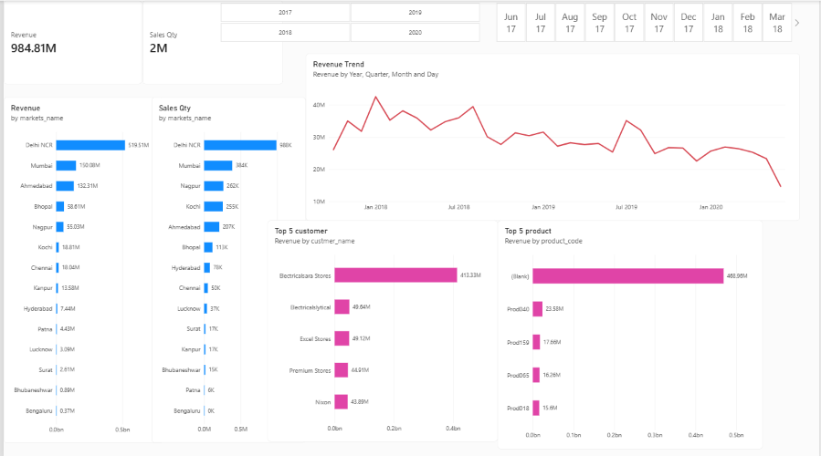

# 📊 Sales Insights Analysis Dashboard

An end-to-end data analysis project simulating real-time business operations for a hardware supplier enterprise. This project integrates **MySQL** for data extraction/ETL and **Power BI** for building dynamic, interactive business intelligence reports.

---

## 📸 Dashboard Overview

---

## 🛠️ Tech Stack & Tools
* **Database & Querying:** MySQL Workbench (Data modeling & initial SQL queries)
* **ETL & Transformation:** Power Query Editor (Data cleansing, currency standardization)
* **Business Intelligence:** Microsoft Power BI Desktop
* **Calculations:** DAX (Data Analysis Expressions) for dynamic KPIs

---

## 🔍 Key Business Insights
* **Revenue Drivers:** Identified top-performing regional markets (Delhi NCR, Mumbai) contributing the largest revenue share.
* **Product Performance:** Analyzed product lines driving volume vs. high-margin revenue.
* **Customer Distribution:** Highlighted top 5 client accounts representing key revenue retention streams.
* **Trend Analysis:** Visualized revenue decline and seasonal sales patterns across quarters.

---

## 📁 Repository Structure
* `sales.pbix` - Complete interactive Power BI dashboard file.
* `db_dump.sql` - Database schema and transactional sales records.
* `dashboard_preview.png` - Visual snapshot of the executive report.
